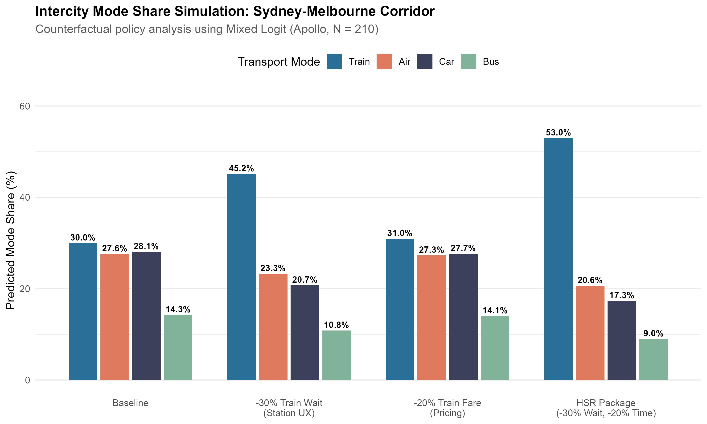

# sydney-corridor-dcm-apollo
# Intercity Mode Choice Modeling: Sydney–Melbourne Corridor (R & Apollo)

An econometric Discrete Choice Modeling (DCM) and counterfactual policy analysis of intercity passenger mode choice in Australia, combining **Multinomial Logit (MNL)** and **Mixed Logit (MXL)** specifications in R using the `apollo` package.

This project bridges quantitative transport econometrics with **human-centered mobility and passenger UX**, evaluating how terminal waiting friction, travel time, ticket pricing, and socio-demographic context shape rail competitiveness against air and private car travel.

---

## Key Findings

* **Superior Model Fit:** Extending the baseline MNL (`LL = -192.89`, 6 parameters) to a Mixed Logit model incorporating socio-demographics (`LL = -172.47`, 13 parameters) yielded a highly significant improvement (**Likelihood Ratio Test = 40.84, df = 7, p < 0.001**).
* **Severe Psychological Penalty of Waiting:** In the baseline MNL model, the Value of In-Vehicle Travel Time (VoT) is **17.20 AUD/hr**, while terminal waiting time carries a **24.3× disutility penalty** relative to in-vehicle travel time—confirming that station friction and schedule uncertainty outweigh pure ride duration.
* **Observed vs. Unobserved Heterogeneity:** In the MXL model (500 Halton draws), higher household income significantly lowers rail utility relative to private car (`b_inc_train = -0.0592, rob. t = -3.64`), and larger travel party size strongly deters air travel (`b_size_air = -0.9224, rob. t = -3.47`). Notably, the random standard deviation of travel time (`sigma_b_travel = 0.0000, rob. t = -0.12`) becomes statistically insignificant once income and party size are controlled, indicating that taste variation in this sample is primarily explained by **observed socio-demographic heterogeneity**.
* **UX & Scheduling Outperform Fare Discounts:** Reducing train waiting time by 30% raises rail mode share by **+15.15 percentage points** (`30.00% → 45.15%`), making it **~16× more effective** than a 20% train fare reduction (`+0.95 pp`).

---

## Methodology & Workflow

1. **Data Transformation:** Reshaped the benchmark Australian intercity mode choice dataset (`TravelMode`, package `AER`; 210 travelers × 4 alternatives: Air, Train, Bus, Car) from long format (840 rows) to Apollo-compatible wide format (210 rows × 16 variables).
2. **Model 1 — Baseline MNL:** Estimated generic waiting time, in-vehicle travel time, and travel cost parameters with Alternative-Specific Constants (`Car` fixed as reference) to derive behavioral indicators (VoT and waiting time penalty).
3. **Model 2 — Mixed Logit (MXL):** Specified a normally distributed random travel time coefficient (`mu_b_travel`, `sigma_b_travel`) simulated via **500 Halton draws**, alongside mode-specific socio-demographic interactions for household income (`income`) and party size (`size`).
4. **Model Validation & Policy Simulation:** Formally compared models via `apollo_lrTest()` and executed counterfactual mode-share forecasts via `apollo_prediction()`.

---

## Model Estimation Results (Model 2: Mixed Logit)

| Parameter | Description | Estimate | Robust t-ratio | Significance |
| :--- | :--- | :---: | :---: | :---: |
| `asc_air` | Alternative-Specific Constant (Air) | 6.0352 | 4.79 | *** |
| `asc_train` | Alternative-Specific Constant (Train) | 5.5735 | 7.82 | *** |
| `asc_bus` | Alternative-Specific Constant (Bus) | 4.5047 | 6.56 | *** |
| `asc_car` | Reference Alternative (Fixed) | 0.0000 | — | Reference |
| `b_wait` | Terminal Waiting Time (min) | -0.1012 | -6.94 | *** |
| `mu_b_travel` | Mean In-Vehicle Travel Time (min) | -0.0041 | -3.99 | *** |
| `sigma_b_travel` | SD of In-Vehicle Travel Time | 0.0000 | -0.12 | n.s. |
| `b_cost` | Travel Cost (AUD) | -0.0087 | -0.99 | n.s. |
| `b_inc_air` | Household Income × Air | 0.0075 | 0.61 | n.s. |
| `b_inc_train` | Household Income × Train | -0.0592 | -3.64 | *** |
| `b_inc_bus` | Household Income × Bus | -0.0209 | -1.55 | n.s. |
| `b_size_air` | Party Size × Air | -0.9224 | -3.47 | *** |
| `b_size_train` | Party Size × Train | 0.2163 | 1.03 | n.s. |
| `b_size_bus` | Party Size × Bus | -0.1479 | -0.56 | n.s. |

*Model fit: Final LL = -172.47 (Baseline MNL LL = -192.89); LR Test = 40.84 (df = 7, p < 0.001); N = 210 travelers; 500 Halton draws.*

---

## Counterfactual Policy & UX Simulations

Using the validated MXL model, three rail-focused interventions were simulated against the observed baseline:

| Policy Scenario | Train (%) | Air (%) | Car (%) | Bus (%) | Train Shift vs. Baseline |
| :--- | :---: | :---: | :---: | :---: | :---: |
| **Baseline** | 30.00% | 27.62% | 28.10% | 14.29% | — |
| **-30% Train Wait (Station UX & Scheduling)** | **45.15%** | 23.27% | 20.74% | 10.84% | **+15.15 pp** |
| **-20% Train Fare (Pricing Policy)** | 30.95% | 27.32% | 27.67% | 14.05% | +0.95 pp |
| **HSR Package (-30% Wait & -20% Travel Time)** | **53.02%** | 20.65% | 17.33% | 9.01% | **+23.02 pp** |



### Policy & Human-Centered Implications
* **Station UX as a High-Leverage Investment:** Cutting terminal wait time by 30% shifts `7.36 pp` away from private cars and `4.35 pp` away from air travel without requiring costly fare subsidies.
* **High-Speed Rail (HSR) Competitiveness:** Combining improved station experience (`-30% wait`) with faster rail operations (`-20% travel time`) pushes rail to a majority share (**53.02%**), reducing car share by **10.77 pp** and air share by **6.97 pp**.

---

## Repository Structure

```text
DCM_Sydney_Choice/
├── sydney_dcm_analysis.R                  # End-to-end R script (MNL, MXL, LR test, simulations, ggplot2)
├── output/
│   └── policy_simulation_mode_shares.png  # Publication-ready policy simulation chart (300 dpi)
└── README.md                              # Project documentation and econometric summary
